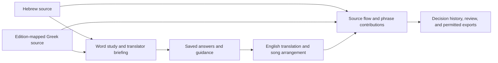

# AlephTav — Psalms Translation Workbench

Local-first Psalms translation and song-arrangement workbench. Study Hebrew and edition-mapped Greek word by word, save briefing decisions that guide translation, and follow source contributions into English lyrics through a visible flow map and decision trail.

GitHub Pages welcome site: https://wirelessdreamer.github.io/AlephTav/

## Features in the current application

The desktop workbench brings together Verses, Arrangement, Sources, Liberties, and Raw text. A focused phone interface offers verse comparison, word evidence, and review, with a Full workbench option for the advanced tools.



- **Hebrew and Greek word study:** interlinear meanings, lexical details, morphology, matching hover outlines, and click-to-open studies in Sources. Pinned studies support keyboard access and close on outside clicks.
- **Translator briefing:** contextual questions include Hebrew, Greek, and literal reading aids. Answers and notes save automatically, restore with the translation, and guide subsequent translation without a separate copy into guidance.
- **Source flow and decision trail:** a visible left-to-right map links sources to the English setting, shows Hebrew and Greek contributions to mixed phrases, follows the source verse while scrolling, and highlights matching English lines.
- **Arrangements and context:** edit stanzas, choruses, repeats, and added lines. Saved line explanations also appear as a Context section in Sources, with unanchored additions labeled clearly.
- **Projects, imports, and history:** organize separate translations, import lyrics, compare literal and lyrical readings, annotate accuracy and creative liberties, and inspect the guidance and decisions used for translations and rebuilds.
- **Reading and recovery:** focused phone views and a full-workbench switch; task-specific loading messages, failure feedback, and retries; saved content remains visible during comparison refreshes.
- **Assistant and export tools:** configured Codex assistance for briefing, translation, and analysis; contextual chat; Markdown, CSV, and print/PDF controls, plus policy-gated release bundles.

The translation workspace focuses on Psalms. Greek lexical lookup resources cover Septuagint and Greek New Testament forms; that does not imply a complete New Testament translation interface. Preview sources, proposed lexical matches, and unresolved words remain labeled. Word glosses are reading aids rather than reviewed sentence translations. Display, generation, and export depend on installed source packages and their permissions; canonical promotion and release retain reviewer approval requirements.

GitHub Pages hosts the feature and setup site. The actual workbench, saved projects, and assistant connections run locally against the API.

## What The Project Includes

- Git-friendly JSON content as the canonical text source of truth.
- Vendored Psalms source inputs under `data/raw/` so the Hebrew corpus rebuild works offline.
- SQLite-derived indexes for concordance, lexical cards, witnesses, retrieval, jobs, and review state.
- FastAPI backend, Typer CLI, and React + TypeScript visual workbench UI.
- Deterministic composer logic plus model-assisted candidate generation hooks for local and configured assistants.
- Audit, provenance, review, validation, release-export, and generated research-report workflows.

## Run The Workbench

Use the platform setup script from the repo root. It verifies required runtimes, installs dependencies, prepares source data and derived indexes, and starts both the FastAPI backend and Vite UI. The PowerShell setup reuses tracked rebuild state when its outputs are current.

### macOS / Linux

```bash
./setup.sh
```

### Windows PowerShell

```powershell
.\setup.ps1
```

By default the scripts:

- require Python `>=3.11`, Node.js, and npm
- create or reuse `.venv`
- install `pip install -e .[dev]`
- run `npm install`
- run the full content rebuild pipeline
- start the API on `http://127.0.0.1:43174`
- start the UI on `http://127.0.0.1:43173`

Open:

- `http://127.0.0.1:43173/` for the welcome page
- `http://127.0.0.1:43173/workbench` or `http://127.0.0.1:43173/#/workbench` for the live workbench

Useful setup options:

```bash
./setup.sh --fixture
./setup.sh --skip-start
./setup.sh --api-port 8010 --ui-port 5174
```

```powershell
.\setup.ps1 -DataMode fixture
.\setup.ps1 -SkipStart
.\setup.ps1 -ApiPort 8010 -UiPort 5174
```

## Rebuild And Validate Content

This is the explicit manual sequence behind the setup scripts when you want to regenerate local project state yourself.

```bash
source .venv/bin/activate
python scripts/seed_project.py
python scripts/import_psalms.py
python scripts/build_indexes.py
python scripts/validate_content.py
python -m uvicorn app.api.main:app --host 127.0.0.1 --port 43174 --reload
```

Common commands:

```bash
psalms-workbench validate-content
psalms-workbench audit-licenses
psalms-workbench export-release --release-id v0.1.0
npm run build
npm test
npm run test:e2e
```

## Screenshots

Refresh the generated documentation screenshots with:

```bash
npm run capture:screenshots
```

When Playwright can launch in your environment, this writes PNG views under `app/ui/public/screenshots/`. The committed capture below is a development reference; the feature list above describes the current workbench:

- `app/ui/public/screenshots/live-translation-flow.png`

The repo also includes committed SVG reference views used by the welcome page and GitHub-rendered docs:

- `app/ui/public/screenshots/translation-workflow.svg`
- `app/ui/public/screenshots/lexical-analysis.svg`

## Documentation

- [`docs/README.md`](docs/README.md): documentation index
- [`docs/CONTRIBUTING.md`](docs/CONTRIBUTING.md): contributor workflow
- [`docs/TRANSLATION_POLICY.md`](docs/TRANSLATION_POLICY.md): canonical vs alternate policy
- [`docs/AUDIT_POLICY.md`](docs/AUDIT_POLICY.md): audit requirements and reports
- [`docs/DATA_SOURCES.md`](docs/DATA_SOURCES.md): upstream source and license policy
- [`docs/RELEASE_PROCESS.md`](docs/RELEASE_PROCESS.md): release workflow and protections

## Branch Protection

The committed `.github/settings.yml` and `docs/RELEASE_PROCESS.md` capture the intended GitHub protection rules for `main`: required approvals, required CODEOWNERS review, and required passing workflows.
